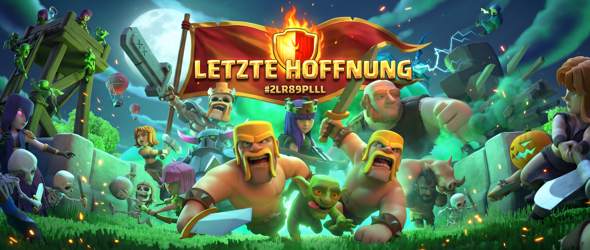

<head>
  <meta property="og:title" content="⚔️ Clan Letzte Hoffnung | RH17 Recruiting" />
  <meta property="og:description" content="Level 19 Clan • RH17 • Strukturierte CW & CWL • Max-Spenden & Aktive Community" />
  <meta property="og:image" content="https://monschtrum.github.io/letzte-hoffnung/Gemini_Generated_Image_aevojbaevojbaevo.jpg" />
  <meta property="og:url" content="https://monschtrum.github.io/letzte-hoffnung/" />
</head>

  
  <h1 style="margin-top: 15px; color: #ffffff;">⚔️ Clan "Letzte Hoffnung"</h1>
  

    Level 19 • RH 17 • Strukturierte Clankriege • Fester Zusammenhalt
  

  <h3 style="margin-top: 0; color: #fff;">🔥 Du suchst ein neues Zuhause in Clash of Clans?</h3>
  

    Willkommen bei <strong>Letzte Hoffnung</strong>! Wir sind ein gewachsener, aktiver und zielstrebiger Level-19-Clan. Bei uns trifft ehrgeiziger Siegeswille in Clankriegen und der CWL auf eine entspannte, hilfsbereite Gemeinschaft. Egal ob erfahrener Taktiker oder ehrgeiziger Wiedereinsteiger – wenn du ein strukturiertes Umfeld ohne Chaos suchst, bist du bei uns genau richtig!
  

  

    <a href="https://link.clashofclans.com/de?action=OpenClanProfile&tag=2LR89PLLL" style="background-color: #f39c12; color: #fff; padding: 14px 28px; text-decoration: none; font-weight: bold; border-radius: 8px; display: inline-block; box-shadow: 0 4px 12px rgba(243,156,18,0.4); font-size: 16px;">
      🎮 CLAN DIREKT IM SPIEL ÖFFNEN & BEWERBEN
    </a>
  

---

## 📊 Live Clan-Übersicht & Stats

  

    CLAN-LEVEL 
    <strong style="font-size: 18px; color: #ffffff;"><!--STAT_LEVEL-->Level 19<!--/STAT_LEVEL--></strong>
  

  

    MITGLIEDER 
    <strong style="font-size: 18px; color: #ffffff;"><!--STAT_MEMBERS-->49/50<!--/STAT_MEMBERS--></strong>
  

  

    TROPHÄEN 
    <strong style="font-size: 18px; color: #ffffff;"><!--STAT_TROPHIES-->Live-Data<!--/STAT_TROPHIES--></strong>
  

  

    CK-SIEGE 
    <strong style="font-size: 18px; color: #ffffff;"><!--STAT_WINS-->Live-Data<!--/STAT_WINS--></strong>
  

 

* 🏰 **Clan-Familie:** Letzte Bastion • Letzte Station
* ⚡ **Philosophie:** Qualität vor Quantität (Keine Rusher)
* 📅 **Tradition:** Erfahrene Clanführung (Est. 2022)

---

## ✨ Was wir dir bieten

  

    <h4 style="margin-top: 0; color: #f1c40f;">🚀 Clan-Vorteile & Max-Spenden</h4>
    
Profitiere von allen Level-19-Boni, raschen Truppenspenden rund um die Uhr und prall gefüllten Clanburgen für deine Kriege und Raids.

  

  

    <h4 style="margin-top: 0; color: #e74c3c;">⚔️ Kriege mit Verstand & Struktur</h4>
    
Gezielte Absprachen in Clankriegen und der CWL. Wir nutzen klare Zielverteilungen auf Discord, um das Maximum an Sternen herauszuholen.

  

  

    <h4 style="margin-top: 0; color: #2ecc71;">🏆 Top-Erfolge in CS & Clanstadt</h4>
    
Die Höchstbelohnungen bei den Clanspielen schalten wir mühelos frei. Am Raid-Wochenende verholen wir gemeinsam tausende Überfall-Medaillen.

  

---

## 🎯 Was du mitbringen solltest

* 🏰 **Rathaus-Level:** **RH 17** (ausgebautes Dorf, keine gerushten Rathaushöhen)
* ⚔️ **Kriegs-Disziplin:** Wer auf *Grün* steht, nutzt im Clankrieg und in der CWL verlässlich beide Angriffe.
* 🤝 **Teamgeist & Aktivität:** Beteiligung an Clanspielen (mind. 1.000 Punkte) und am Raid-Wochenende der Clanstadt.
* 💬 **Kommunikation:** Freundlicher Umgang im Chat und Bereitschaft, Discord für Kriegsorganisation zu nutzen.

---

## 👑 Führungsteam & Ansprechpartner

  

    ANFÜHRER 
    <strong style="font-size: 16px; color: #ffffff;">👑 MuSKELBaNaNe</strong>
  

  

    VIZE-ANFÜHRER 
    <strong style="font-size: 16px; color: #ffffff;">⚔️ Th3rion</strong>
  

---

## 📈 Live Clan-Statistiken & Historie

  <h3 style="margin-top: 0; color: #fff;">📈 Transparenz & Kriegsbilanz</h3>
  

    Möchtest du unsere Kriege, Trophäenverläufe und Aufstellungen im Detail analysieren? Werfe einen Blick auf unser offizielles Profil bei Clash of Stats:
  

  <a href="https://www.clashofstats.com/clans/2LR89PLLL/summary" target="_blank" rel="noopener noreferrer" style="background-color: #3498db; color: #fff; padding: 12px 20px; text-decoration: none; font-weight: bold; border-radius: 6px; display: inline-block; box-shadow: 0 4px 8px rgba(0,0,0,0.3);">
    📊 Clan-Profil auf Clash of Stats öffnen ↗
  </a>

---

## 📜 Unsere Clan-Regeln im Überblick
1. **Clankrieg & CWL:** Wer auf "Grün" geschaltet ist, macht beide Angriffe. Absprachen erfolgen strukturiert.
2. **Clanspiele & Clanstadt:** Aktive Pflichtteilnahme – gemeinsam holen wir alle Prämien.
3. **Kein Rushing:** Wir legen Wert auf gepflegte Dörfer und Helden.
4. **Spendenkultur:** Angemessenes Geben und Nehmen, genaue Anfragen werden zügig bedient.

---

## 💬 Werde Teil der Familie!

Du möchtest dich vor dem Beitritt austauschen oder Fragen stellen? Tritt unserem Discord-Server bei oder schicke uns direkt eine Anfrage im Spiel:

  <a href="https://discord.gg/gEmbask" target="_blank" rel="noopener noreferrer" style="background-color: #5865F2; color: #fff; padding: 14px 24px; text-decoration: none; font-weight: bold; border-radius: 8px; display: inline-block; box-shadow: 0 4px 10px rgba(88,101,242,0.4);">
    💬 Discord Beitreten
  </a>
  <a href="https://link.clashofclans.com/de?action=OpenClanProfile&tag=2LR89PLLL" style="background-color: #f39c12; color: #fff; padding: 14px 24px; text-decoration: none; font-weight: bold; border-radius: 8px; display: inline-block; box-shadow: 0 4px 10px rgba(243,156,18,0.4);">
    ⚔️ Im Spiel anfragen
  </a>

  Clan "Letzte Hoffnung" (#2LR89PLLL) • Hosted on GitHub Pages

